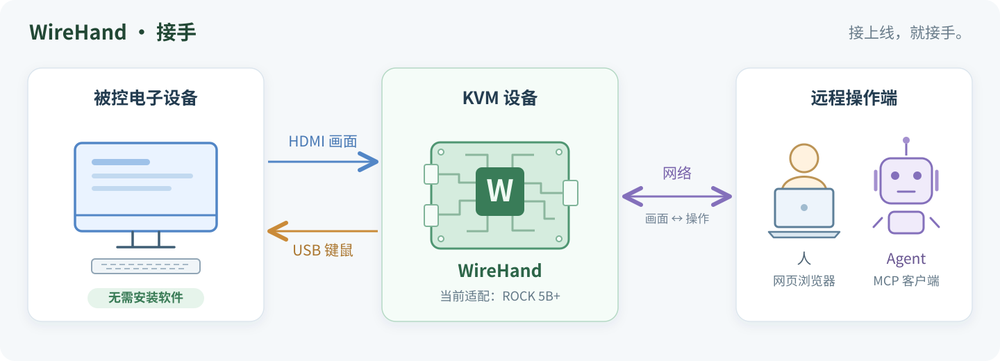
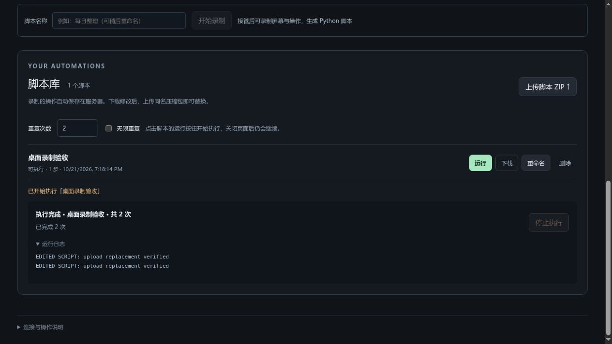

# WireHand · 接手

**被控设备无需安装任何控制软件：只要能输出视频信号、接受键盘鼠标输入，就能通过相应的视频与键鼠接口接入控制，可远程操控与录制操作脚本，提供MCP服务器。**

WireHand 从视频输出观察设备界面，通过模拟键盘鼠标发送操作。控制对象不限于电脑，也包括具备相应接口的其他电子设备；网页服务、视觉识别和脚本执行都运行在外部控制端，被控设备只需输出画面并接收键鼠输入。

当前硬件适配使用 **ROCK 5B+ 的 HDMI 输入与 USB HID 键盘鼠标**，接入具有兼容视频输出和标准 USB 键鼠输入的设备。接好线后，即可通过网页手动操作、使用 Python 编写自动化，或交给支持 MCP 的 AI agent 控制。

录制时，鼠标按下会提取点击附近的图像作为目标；重放时重新定位目标。键盘、鼠标移动和滚轮保留输入、位置与时间间隔。脚本、目标图片和桌面数据均保存在自己的服务器上，视觉处理使用本地 OpenCV。

## 工作原理



箭头表示画面和操作的传递方向：被控设备向 KVM 输出画面，KVM 将远程操作转换成标准键鼠输入。人通过网页接管，agent 通过 MCP 调用工具；视觉识别、录制和脚本执行都在 KVM 控制端完成。

图中展示实体设备的远程接入方式；同机 MCP 客户端可直接使用 stdio。Docker 桌面提供虚拟屏幕与键鼠后端，用于无板卡体验和开发。

## 适合哪些场景

| 场景 | 使用方式 |
| --- | --- |
| 控制不便或无法安装控制软件的电子设备 | 连接视频输出和键鼠接口，通过外部控制端查看与操作 |
| 重复执行桌面或网页中的固定流程 | 在网页接管设备并录制，保存后设置执行次数或无限重复 |
| 先演示操作，再用代码调整细节 | 下载 ZIP，修改 `replay.py`，上传同名文件替换并重新执行 |
| 给 AI agent 提供可观察、可操作的桌面 | 接入 MCP，查看截图或编号目标，再发送键鼠操作 |
| 开发和调试视觉自动化 | 使用 Docker 桌面、模拟画面或离线截图，无需先接入板卡 |

控制实体设备从 [ROCK 5B+ 接线与部署](docs/rock5b-plus/README.md) 开始；想先体验网页、录制与脚本功能，可以使用下面的 Docker 桌面。

## 快速开始：Docker 桌面

需要 **Linux、Docker Engine、Docker Compose 插件和 Python 3**。下载或克隆本仓库后，在仓库根目录执行：

```bash
./deploy/docker-desktop/desktopctl init
./deploy/docker-desktop/desktopctl up
./deploy/docker-desktop/desktopctl status
```

首次启动会构建镜像并安装桌面环境。打开 **<http://127.0.0.1:18810/>**，使用 `deploy/docker-desktop/.env` 中自动生成的 `KVM_TOKEN` 登录。

容器内预装 Xfce、Firefox ESR、终端和文件管理器。默认只监听本机回环地址；部署在远端服务器时，在自己的电脑上建立 SSH 隧道：

```bash
ssh -N -L 18810:127.0.0.1:18810 user@server
```

随后仍访问 `http://127.0.0.1:18810/`。桌面主目录、`/workspace` 和脚本库分别保存在 Docker 命名卷中，重建容器后保留。

常用管理命令：

```bash
./deploy/docker-desktop/desktopctl logs       # 查看日志
./deploy/docker-desktop/desktopctl restart    # 重启当前版本
./deploy/docker-desktop/desktopctl up         # 构建并启用更新后的代码
./deploy/docker-desktop/desktopctl down       # 停止服务，保留数据卷
```

分辨率、局域网访问、备份与恢复见 [Docker 桌面指南](docs/DOCKER_DESKTOP.md)。

## 网页录制与脚本执行

1. 点击 **接管控制**，使用画面中的鼠标和键盘操作设备。
2. 输入脚本名称，点击 **开始录制**，完成希望重复执行的操作。
3. 点击 **停止并生成脚本**，脚本和目标图片自动保存到服务器的脚本库。
4. 点击 **结束接管**，设置重复次数或无限重复，再点击脚本的 **运行**。
5. 在运行面板查看进度和日志；点击 **停止执行**，或重新接管设备，即可停止任务。

下载文件名与脚本名称对应，例如 `每日整理.zip`。解压后可以修改 `replay.py`、添加辅助模块，再上传同名 ZIP；网页会提示是否替换，实际运行的是修改后的 Python 文件。



网页只有接管和非接管两种模式。接管时由当前浏览器独占输入；脚本运行时由该任务独占自动输入。关闭浏览器会结束手动接管，已经启动的服务器脚本任务继续运行。

完整流程、压缩包格式与存储目录见 [网页控制台指南](docs/WEB_CONSOLE.md)。

## Python SDK

SDK 提供截图、点击、键盘、滚轮、拖动、视觉等待和录制接口。它与网页共用同一套设备适配器与输入控制规则。

在 Docker 桌面中，先进入容器：

```bash
./deploy/docker-desktop/desktopctl shell
```

然后运行：

```python
from wirehand import connect

with connect() as computer:
    print(computer.size())
    computer.screenshot().save('/workspace/screen.png')
    # 确认屏幕坐标后，可以发送操作：
    # computer.click(320, 240)
    # computer.hotkey('ctrl', 'a')
    # computer.write('hello')
```

容器已配置后端和运行目录。SDK 在设备后端所在环境执行：Docker 脚本在容器中运行，ROCK 脚本在板子上运行。宿主机上的 `connect(backend='docker-desktop')` 不会自动连接容器。

录制文件中的图像目标也可以用于手写脚本：

```python
from pathlib import Path
from wirehand import connect
from wirehand.automation import Recording

flow = Recording.load(Path('/workspace/my-flow'))  # 解压后的录制目录
with connect(timeout=15) as computer:
    computer.click(target=flow.target('target_0001'))
    computer.write('hello')
```

目标 ID 取自 `recording.json`。像素坐标、图像匹配和取消行为见 [SDK 与录制说明](docs/AUTOMATION.md)。网页右上角的 **SDK 文档** 从当前接口自动生成，也可以在源码环境导出：

```bash
uv sync --frozen
uv run wirehand-docs --output artifacts/sdk-docs
```

## MCP 接入

支持 stdio 的 MCP 客户端可以使用以下配置，把路径替换为本机仓库的绝对路径；Docker 桌面需先启动：

```json
{
  "mcpServers": {
    "desktop": {
      "command": "/absolute/path/to/wirehand/deploy/docker-desktop/desktopctl",
      "args": ["mcp"]
    }
  }
}
```

工具提供截图、按键、文本输入、鼠标操作，以及 `inspect_screen` / `inspect_region` / `click_target`。agent 可以选择图像中的编号来点击；密集画面先分区，再返回放大的局部标记图。

浏览器接管或服务器脚本执行期间，MCP 工具返回占用错误。结束接管或任务后可继续调用。连接方式、工具参数与排查方法见 [MCP 接入指南](docs/MCP.md)。

## 控制电子设备：ROCK 5B+

将被控设备的 **HDMI OUT 接到 ROCK 5B+ 的 HDMI IN**，再用板子的 USB-C 数据口连接被控设备的 USB 主机口。板子独立供电，被控设备通过 HDMI 输出画面、通过 USB 接收标准 HID 键鼠事件，无需安装控制软件。

完成板端驱动、USB gadget 和 EDID 配置后，在板子的仓库目录运行：

```bash
uv sync --frozen
uv run wirehand-web --backend rock5b-plus
```

启动前需配置 `KVM_TOKEN` 等环境变量。接线、系统依赖、服务安装和 SSH MCP 配置见 [ROCK 5B+ 部署指南](docs/rock5b-plus/README.md)；跨网络观看见 [SSH / HTTPS 与视频传输](docs/REMOTE_VIEWING.md)。

## 当前支持范围

- **运行环境**：服务端使用 Linux/POSIX 输入锁；Docker 桌面已在 ARM64 Linux 上验证。
- **画面**：Docker 桌面提供最高 5fps 的 JPEG 预览；ROCK 后端支持硬件视频路径，网页可使用 H.264 WebSocket、MSE、WebRTC 或 JPEG，取决于驱动和浏览器能力。
- **录制**：捕获经过网页或 SDK 的操作。鼠标按下时生成局部 target；键盘、移动和滚轮不生成 target。直接接在目标电脑上的物理键鼠不进入该录制通道。
- **重放**：点击目标会重新匹配；目标消失或匹配不唯一时停止。键盘焦点、菜单布局和输入法状态仍需与流程一致。
- **输入与权限**：文本输入采用 US 布局 ASCII 约定；音频和剪贴板通道尚未提供。上传的 Python 脚本以服务器服务用户身份执行。

## 文档与开发

- [文档导航](docs/README.md)：按任务选择指南。
- [配置参考](docs/CONFIGURATION.md)：后端、端口、访问密码与运行目录。
- [贡献与本地开发](CONTRIBUTING.md)：安装源码、无硬件演示、测试和构建。
- [架构与扩展](docs/ARCHITECTURE.md)：一个安装包，按硬件、视觉、自动化和应用职责分目录。
- [视觉定位](docs/VISUAL_TARGETING.md)：候选检测、分区、分页和按编号点击。

## 许可证

本项目采用 [MIT License](LICENSE)。
