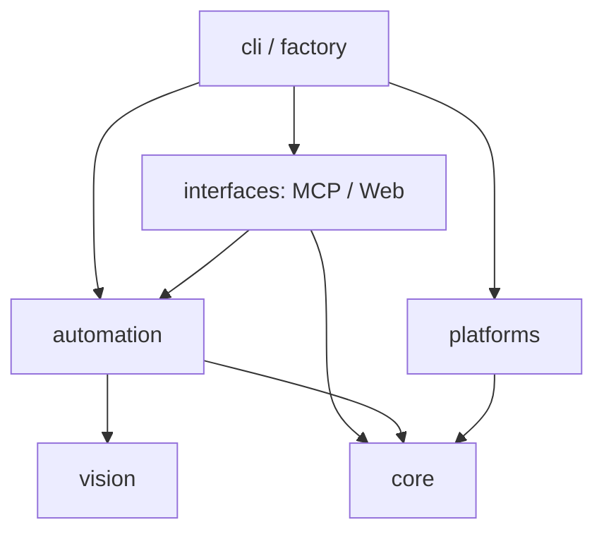

# 架构与扩展约定

## 一个项目，按职责分目录

根目录的 `pyproject.toml` 是唯一的安装配置；`uv sync --frozen` 安装整个项目，`uv build` 生成一个 wheel 和一个源码归档。Python 导入统一使用 `kvm` 命名空间。

```text
src/kvm/
├── core/
│   ├── contracts.py            Backend、InputSession、VideoSource 协议
│   ├── media.py                编码帧发布与订阅
│   ├── locking.py              POSIX 文件锁
│   └── ownership.py / keys.py  控制权、输入 revision、逻辑修饰键
├── vision/
│   ├── models.py               候选、检测器协议、标记与分区
│   ├── images.py               图片解码与画面差异
│   ├── detection.py            候选检测
│   ├── matching.py             持久化视觉目标与歧义检测
│   └── rendering.py            分组、裁剪、总览与编号渲染
├── automation/
│   ├── computer.py             Python 操作 API、等待、取消与重放执行
│   ├── inspection.py           快照会话、分页、细化、点击前校验
│   └── recording/
│       ├── schema.py / model.py 数据校验、加载与目标引用
│       ├── anchors.py          选择可唯一匹配的模板并保存图片
│       ├── recorder.py         录制生命周期与动作归并
│       ├── session.py          输入会话包装：操作前截图、成功后记录
│       └── script.py / archive.py Python 脚本生成与 ZIP 导出
├── platforms/
│   ├── registry.py             内置名称与 module:factory 的延迟加载
│   ├── image.py                无硬件的只读图片后端
│   ├── docker_desktop/         Xvfb 截图、XTEST 输入、JPEG 预览
│   └── rock5b_plus/            HDMI、HID、编码、截图、gadget、EDID
├── interfaces/
│   ├── mcp/server.py          MCP 工具与结果格式
│   └── web/
│       ├── app.py / services.py 组装、资源生命周期与应用实例状态
│       ├── auth.py / control.py 登录、浏览器键位与控制会话
│       ├── routes/            页面、状态、控制、视频和录制下载路由
│       ├── video/             H.264 WebSocket 与 WebRTC 传输
│       └── static/            HTML、CSS、JavaScript
├── cli/                       服务启动与离线视觉检查命令
└── factory.py                 connect()：配置、后端选择与 SDK 实例组装
```

## 依赖方向



- `core` 不依赖其他业务层；`vision` 只处理图像与视觉数据，不捕获屏幕、不管理锁、不发送输入。
- `automation` 依赖 `core` 和 `vision`，通过注入的 `Backend` 工作，不选择硬件、不读取应用配置。
- `platforms` 实现 `core` 协议，不依赖自动化、视觉、MCP 或网页。ROCK 的初始化和资源与设备实现放在同一目录。
- `interfaces` 负责协议、认证、浏览器行为与展示。MCP 与网页不直接导入平台，两者不互相依赖。
- `factory.py` 和 `cli/` 是组装入口。`connect()` 选择后端再构造 `Computer`；应用开发也可以直接注入替代后端。

`tests/test_architecture.py` 检查导入方向，并在独立 Python 进程中验证：SDK 不加载应用或硬件，视觉不加载设备或自动化逻辑，平台不加载应用框架。安装层面统一依赖，模块层面保持边界。

没有增加硬件 RPC 服务。应用、SDK 与设备适配器在同一机器中调用；远程使用可通过 SSH 运行脚本，或实现一个远程 `Backend`。

## 接口

| 接口 | 责任与返回值 |
| --- | --- |
| `Backend.name` | 平台标识，用于状态展示 |
| `Backend.status()` | 平台状态与诊断，包括 `platform`、`input`、`video`；不包含人工控制策略 |
| `Backend.input_state()` | `{"connected": bool, "detail": str}`；不要求应用认识 USB 状态码 |
| `Backend.screenshot(max_width)` | 新鲜 JPEG 字节，按比例缩小至不超过指定宽度；范围 320..3840 |
| `Backend.open_input()` | 上下文管理器，打开 `InputSession`，退出时释放设备资源 |
| `Backend.create_video()` | 创建 `VideoSource`；构造时不启动设备 |
| `InputSession.keys(keys)` | 设置当前按住的逻辑键；空列表释放 |
| `InputSession.pointer(x,y,buttons,wheel)` | 设置绝对位置、持续按钮状态和相对滚轮；坐标为 0..1，按钮位为左 1/右 2/中 4 |
| `InputSession.press_key/type_text/click` | 一次性动作；无效输入不发出任何事件，动作结束或失败均尝试释放 |
| `InputSession.release_all()` | 尝试释放键盘和指针按钮，再汇总报错；保留指针位置 |
| `VideoSource.run()` | 持续采集、恢复信号；取消时清理子进程与占用的设备 |
| `VideoSource.next_frame(after)` | 等待更新且新鲜的 `(sequence, jpeg_bytes)`，慢客户端跳帧 |
| `VideoSource.status()` | 至少包含 `signal`、`error`，有画面时提供 `width/height`；帧率等诊断可选 |
| `VideoSource.encoded` | `EncodedHub` 或 `None`；后者表示只支持 JPEG |

键名采用小写逻辑键，例如 `ctrl`、`a`、`enter`、`f2`。`type_text` 接受 1..1000 个 US 布局 ASCII 字符；`press_key` 的保持时间为 10..1000ms；滚轮为 -127..127。平台负责将这些语义转换为设备协议，并在写入前完成整条请求校验。浏览器 DOM 键名到逻辑键名的映射属于应用。

H.264 平台在同一个 asyncio 事件循环中调用 `encoded.publish(data, pts, keyframe)`。`data` 是 Annex-B access unit，`pts` 为单调递增的 90kHz 时间戳。编码不得使用 B 帧，关键帧应包含解码所需 SPS/PPS；编码器重启时调用 `encoded.reset()`。WebRTC 消费者使用最多四帧的队列；WS/WSS 消费者使用两帧待发队列及有 ACK 的发送窗口，溢出后丢弃预测链并等待下一个关键帧。此接口不要求平台构造 aiortc 对象。

`interfaces/web/video/h264.py` 订阅 `EncodedHub`，保存 SPS/PPS，向新观看者发送可独立解码的 IDR。`/ws/h264?format=annexb` 供 WebCodecs 使用；`format=mp4` 使用 PyAV 重新封装为 fMP4，供 MSE 使用，不进行二次编码。两者均复用网页登录、同源检查与会话失效处理。客户端只有在绘制完成或分片追加完成后才 ACK。具体窗口、重同步和 Nginx TLS 边界见 [远程视频](REMOTE_VIEWING.md)。

同步平台方法允许阻塞；HTTP 状态查询和输入由 `asyncio.to_thread` 调用。视频生命周期与订阅运行在事件循环。平台模块导入时不访问设备。

## 控制权与运行目录

同一目标的所有进程共用 `KVM_RUNTIME`。`core/locking.py` 只提供互斥；`core/ownership.py` 在互斥内检查 `human-control` 标记，平台不知道“人工”或“MCP”。

1. MCP 输入获取 `input.lock`，检查接管标记，再打开输入会话。结束后推进 `input-revision`，使其他进程中的旧视觉快照失效。
2. 浏览器接管获取同一把锁，打开输入会话，创建标记并释放残留按键；持锁直至断开或交还。获取和释放人工会话均推进 revision。
3. 正常断开、七秒无消息超时或输入错误会释放键鼠和会话，在持锁期间删除接管标记，然后交还输入锁。释放失败仍结束接管，错误会被报告或记录。
4. 明确交还与断开使用同一条清理路径。进程被强制终止时，重启会在获取输入锁后尝试释放遗留按键并删除旧标记；获取不到锁时不打断其他活动会话。

ROCK 适配器额外使用 `video.lock` 协调长时间采集与独立截图，并通过原子替换的 `frame.jpg` 共享最近画面。这个缓存是适配器实现细节。视频退出持锁完成进程回收和缓存清理；未取得锁的实例不删除其他进程的缓存。

## 扩展入口

新增平台时，在 `src/kvm/platforms/<name>/` 内实现接受 `runtime: Path` 的工厂或类，遵循 `core/contracts.py`。通过完整工厂路径启动即可：

```sh
kvm-web --backend kvm.platforms.my_platform.backend:create_backend
kvm-mcp --backend kvm.platforms.my_platform.backend:create_backend
```

常用内置平台可在 `platforms/registry.py` 的 `BUILTINS` 中增加一个名称，不需要新的安装包或 entry point。初始化脚本、驱动配置和专用资源放在平台目录。

`docker-desktop` 是容器内的 X11 适配器，构造时不访问显示器。Compose 负责桌面生命周期和数据卷；平台通过 XTEST 发送输入、读取 Xvfb 根窗口生成 JPEG，以 5fps 的最新帧源接入现有网页。MCP 通过 `desktopctl mcp` 在同一容器内运行，共用输入锁；不额外开放 VNC 或自建控制权协议。部署配置位于 `deploy/docker-desktop/`，见 [Docker 桌面](DOCKER_DESKTOP.md)。

扩展视觉检测时，实现 `vision/models.py` 的 `Detector.detect(image)`，向 `Inspector` 或 `Recorder` 注入；扩展录制动作时，同时更新 `recording/schema.py`、事件归并及 `Computer` 的执行方法。脚本生成器只输出可编辑的 Python 调用，不依赖 MCP、HTTP 或模型服务。

新增网页功能时，路由放入 `interfaces/web/routes/`，共享实例放入 `WebServices`，`app.py` 只负责注册和生命周期。后台输入与截图是同步方法，异步路由需通过线程调用。

应用测试以 `tests/fakes.py` 为后端参考；平台测试验证 HID、EDID、视频解析与资源生命周期。无硬件的开发入口：

```sh
# 离线标注与分页检查
uv run kvm-inspect /path/to/screen.png --output artifacts/vision/check

# 在同一张图片上调试 MCP 观察工具，不提供输入和视频流
KVM_SCREENSHOT=/path/to/screen.png uv run kvm-mcp --backend image --runtime /tmp/kvm-image

# 可操作的模拟网页与录制
uv run python examples/web_recording_demo.py
```

## 入口与录制数据

SDK 连接入口是 `from kvm import connect`；显式注入使用 `from kvm.automation import Computer`。视觉目标从 `kvm.vision` 导入。根目录不保留旧命名空间、子项目配置或兼容别名，已有脚本需更新导入和连接调用。

安装后仍使用 `kvm-mcp`、`kvm-web`、`kvm-inspect` 和平台初始化命令。静态文件与 EDID 随同一个 wheel 分发。

视觉快照编号只属于短期观察。录制脚本使用 `VisualTarget` 的图像、点偏移和参考尺寸重新匹配，不持久化旧编号；新生成的脚本使用 `connect()`。录制与重放格式见 [AUTOMATION.md](AUTOMATION.md)。
