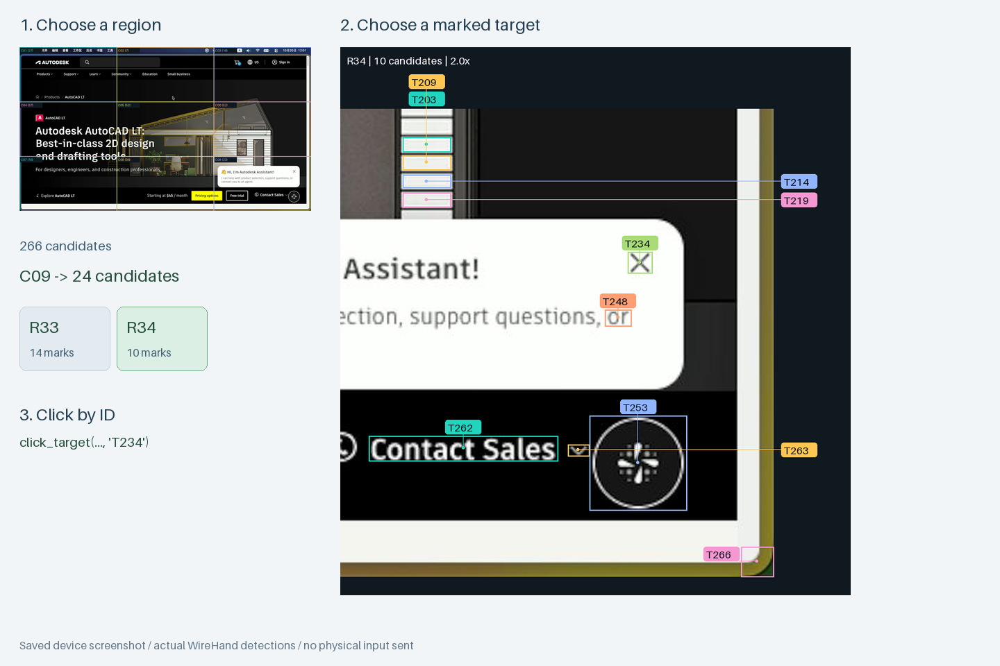

# 视觉定位：从设备画面到操作目标

[返回文档导航](README.md)

HDMI 采集提供的是画面。WireHand 将画面中的候选区域转成带编号的操作目标，让 agent 选择目标编号，由程序完成原图坐标映射；录制时则将点击附近的图像保存下来，供脚本重放时重新定位。

**这套设计把被控端免安装、agent 按编号操作、用户演示生成脚本连接在一起。** 检测与匹配在控制端本地运行，使用 OpenCV 图像特征，适用于 HDMI 画面、Docker 桌面及其他能提供截图的后端，不依赖被控应用的 DOM、无障碍树或专用控制 API。

## 它解决什么问题

| 操作中的问题 | WireHand 的处理方式 |
| --- | --- |
| 全屏截图里的小按钮难以精确估计坐标 | 自动生成候选框和编号，agent 用 `target_id` 选择，程序计算点击点 |
| 标记太多，图像和编号互相遮挡 | 先看区域总览，再放大局部；每张局部图最多 18 个候选，支持分页 |
| 多张图对应不同时刻，无法确认目标是否还是原来的位置 | 同一次观察的总览、分页和细分共用一个截图快照 |
| 观察后发生滚动、人工接管或界面变化 | 点击前检查快照、输入状态和新画面，过期或变化时要求重新观察 |
| 手写录制脚本需要反复裁图、匹配、等待 | 鼠标按下时自动保存局部 target，重放时等待匹配稳定并重新定位 |

## 真实设备截图示例

下图来自 **ROCK 5B+ HDMI 输入采集的真实 1920×1080 屏幕**。右下角是网页助手弹窗的关闭按钮。这里在保存的采集帧上离线运行当前算法，未向现场设备发送点击。



原始画面见 [真实采集帧](images/visual-real-screen.jpg)，也可单独查看[区域总览](images/visual-overview.png)和[完整局部标记图](images/visual-region.png)。本次输出为：

| 阶段 | 实际结果 |
| --- | --- |
| 全屏检测 | 266 个候选，首先显示 C01–C09 九宫格总览 |
| 选择右下角 C09 | 24 个候选，拆成 R33、R34 两张放大图 |
| 单张图的标记数量 | R33 有 14 个，R34 有 10 个 |
| 选择关闭按钮 | R34 中的 `T234`，对应原图点 `(1808.5, 818.5)` |
| 局部图与原图的关系 | 放大图上的文字和标记只用于展示，输入坐标始终从原图计算 |

候选中也包含插画线条和说明文字。agent 需要根据画面选择真正想操作的控件；检测器不读取“关闭”等文字语义。

## agent 如何按编号操作

以下是 MCP 工具调用顺序，用 `S` 代表 `inspect_screen` 本次返回的 `snapshot_id`：

```text
inspect_screen()
  → snapshot_id=S, presentation="regions"
  → 一张带 C01–C09 的总览图

inspect_region(snapshot_id=S, region_id="C09")
  → 同一帧的区域总览 + R33、R34 两张局部图
  → targets 中包含关闭按钮的 T234

click_target(snapshot_id=S, target_id="T234", button="left")
  → 校验画面与控制权，再发送键鼠输入
```

这些编号来自上面的截图示例。实际调用使用当前响应中的编号和快照 ID；点击或其他输入发生后，重新 `inspect_screen` 再进行下一步。

### 密集画面如何拆图

- 普通画面返回总览和局部标记图，每张局部图最多 18 个候选。
- `page_size` 控制一次返回几张局部图，默认 3，范围 1–4；每次另带一张总览。
- 超过 180 个候选时，先返回 3×3 区域总览，让 agent 选择需要看的区域。
- 分页和区域细分复用同一帧，已有目标 ID 在该快照内保持一致；局部重新检测可能补充新候选。

普通模式 `presentation="targets"` 下，根据返回的 `next_page` 调用 `inspect_screen(snapshot_id=S, page=...)`。区域细分的分页则继续使用相同的 `inspect_region(snapshot_id=S, region_id=..., page=...)`。

高密度模式下需要浏览全部候选时，使用 `inspect_region(snapshot_id=S, region_id="FULL")` 并按其 `next_page` 翻页。

### 没检测到想点的位置

可以将区域切换到 4×4 网格模式：

```text
inspect_region(snapshot_id=S, region_id="C09", mode="grid")
  → 16 个带编号的网格区域

inspect_region(snapshot_id=S, region_id=<选中的网格 ID>, mode="grid")
  → 再细分该网格
```

每个网格也是可选目标，重复细分可以缩小点击范围。该过程仍使用同一张原始截图。

## 录制脚本如何使用视觉 target

网页或 SDK 录制时，**只有鼠标按下才截图并提取局部 target**；拖动复用按下时的起点图像。键盘、移动和滚轮保留输入、位置与时间间隔，不生成新的视觉目标。

以真实截图中的关闭按钮为例，离线演示程序使用同一套录制逻辑得到：

```json
{
  "image": "assets/target_0001.png",
  "point": [21.5, 20.5],
  "screen_size": [1920, 1080],
  "strategy": "element"
}
```

`point` 是模板左上角到实际点击位置的偏移；`screen_size` 是录制时的截图尺寸。重放时在当前屏幕中查找模板，恢复点击偏移，并在位置连续两帧稳定后发送输入。模板仍可识别时，按钮位置变化也能重新定位。

下面的代码运行在已配置后端的环境中，例如 Docker 容器内或板子上：

```python
from wirehand import connect
from wirehand.automation import Recording

flow = Recording.load('my-recording')  # 网页下载包解压后的目录
with connect(timeout=15) as computer:
    computer.click(target=flow.target('target_0001'))
```

两类编号的用途不同：

| 标识 | 用途 | 生命周期 |
| --- | --- | --- |
| `S` + `T234` | agent 对某次观察结果的选择，点击前校验画面 | 当前快照，默认最多 120 秒 |
| `target_0001` | 录制目录中的图像模板和点击偏移，重放时重新查找 | 随脚本保存，可跨进程使用 |

点击时保存局部模板；无候选元素时保存附近小块图像，不扩大到整屏，也不要求录制当时必须唯一匹配。重放时仍会检查最低匹配分数与候选歧义：目标消失或存在多个近似匹配时停止。

## 复现文档中的结果

仓库包含上述真实采集帧。无需连接板卡即可运行：

```bash
uv sync --frozen
uv run python examples/visual_targeting_demo.py docs/images/visual-real-screen.jpg \
  --region C09 --target T234 --output artifacts/vision/real-example
python3 -m http.server 8765 --bind 127.0.0.1 --directory artifacts/vision/real-example/gallery
```

输出目录需为空。打开 <http://127.0.0.1:8765/>，点击候选编号查看原图中的位置。示例会生成：

- `overview-overview.png`：全屏区域总览。
- `region-R33.png`、`region-R34.png`：实际返回的两张局部标记图。
- `result.json`：候选数量、区域、坐标和模拟输入记录。
- `recording/`：从该帧生成的单次点击录制，包括局部模板和 `replay.py`。
- `visual-targeting.png`：文档中的对照图。
- `gallery/`：包含全部候选的只读 HTML 检查页。

示例的输入后端只在内存中记录点击。分页与细分只读取一帧，模拟点击时再读取一帧做校验；结果中 `physical_input_sent` 为 `false`。这验证了编号到坐标和目标模板生成，真实设备上的操作反馈需在实际控制会话中确认。

也可以在这张真实截图上验证生成的模板：

```python
from PIL import Image
from wirehand.automation import Recording
from wirehand.vision.matching import locate

flow = Recording.load('artifacts/vision/real-example/recording')
with Image.open('docs/images/visual-real-screen.jpg') as frame:
    match = locate(frame.convert('RGB'), flow.target('target_0001'))
print(match.point)  # 本例为 (1808.5, 818.5)
```

处理自己的截图时，先不传 `--target`，查看导出的标记图，再选择对应编号；也可以直接使用通用导出工具：

```bash
uv run wirehand-inspect /path/to/screenshot.jpg --output artifacts/vision/my-screen
```

## 当前实现与点击校验

`wirehand.vision` 处理候选检测、模板匹配和标记渲染；`wirehand.automation.inspection.Inspector` 管理快照、分页和点击校验；MCP 将这些能力暴露为工具，平台只需提供截图与键鼠输入。

检测器通过边缘、局部对比度与形态学操作生成候选，合并文字碎片、移除重复轮廓，再按空间位置分组。局部图最高放大 2.5 倍；标记避开候选框，放不下时移到侧栏并用连线指向原图位置。

每个 MCP 进程最多保存 4 个快照。点击前检查：

1. 快照存在且未过期，控制权和输入 revision 没有变化。
2. 新旧截图分辨率一致。
3. 全局缩略图和目标附近的像素变化未超过阈值。

当前画面变化检测使用模糊后的 RGB 差异：超过 24/255 视为变化，全局变化比例超过 4% 或目标邻域超过 8% 时拒绝点击。小幅时钟变化通常被容忍。该检查是启发式，截图与设备输入之间仍有时间间隔；ROCK 的共享截图还受两秒缓存规则影响。

MCP 输入以及人工接管会推进 `input-revision`，旧快照随之失效。成功点击后清空当前进程的快照。模板重放的等待、取消和输入规则见 [SDK 与录制说明](AUTOMATION.md)，MCP 连接配置见 [MCP 接入](MCP.md)。

## 采集新的设备截图

板端网页正在采集 HDMI 时，可读取最新共享帧：

```bash
uv run python scripts/capture_frame.py root@rock-kvm --output artifacts/vision/live.jpg
uv run wirehand-inspect artifacts/vision/live.jpg --output artifacts/vision/live
```

替换 SSH 主机名。采集脚本只复制最近两秒内的共享帧，不启动新的采集进程、不发送 USB 输入。
